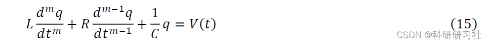
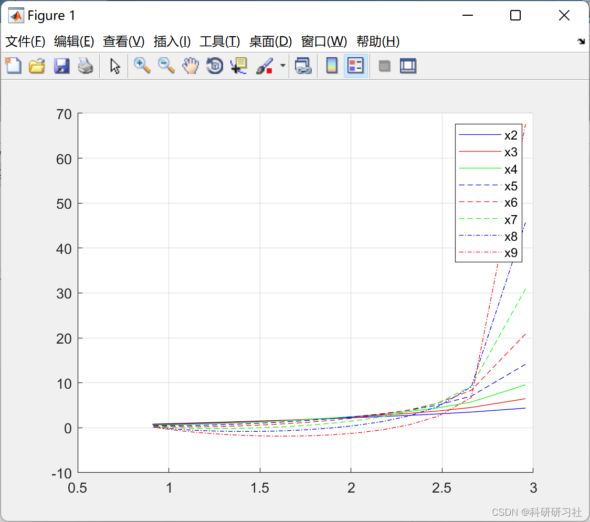
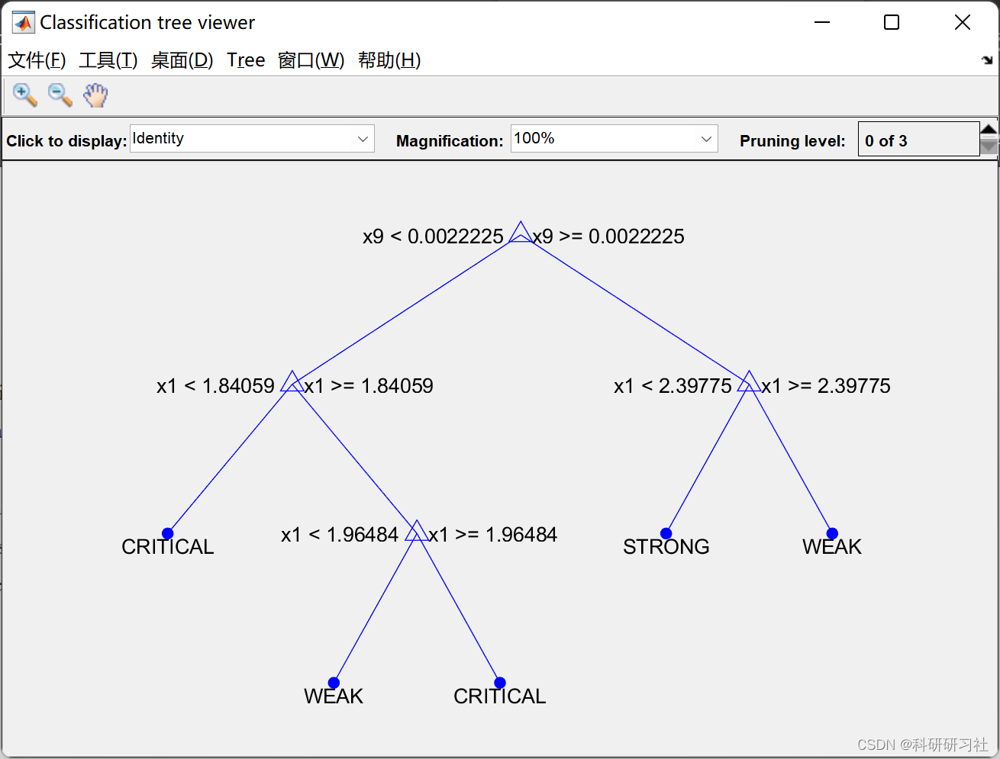
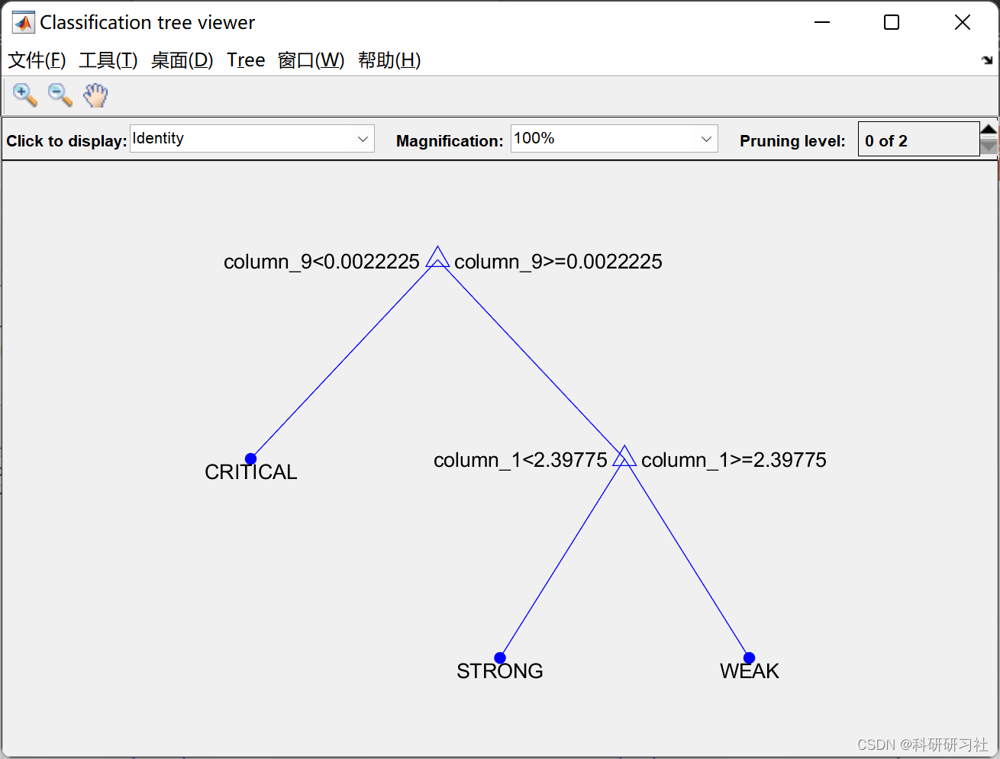
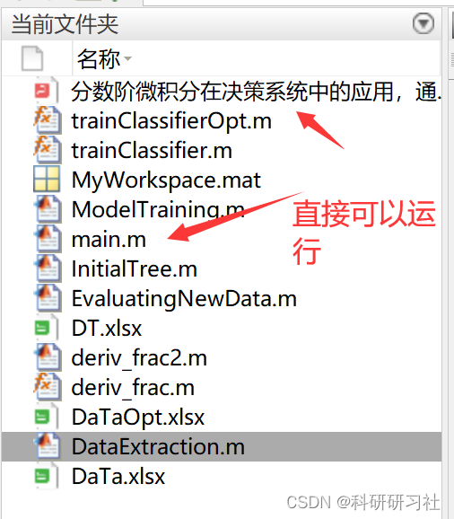

# [Intelligent Grid]Application of Fractional Derivatives in Decision Systems, Realized through a Decision Tree for Intelligent Grid Management (Matlab Code)

​  
This paper describes the relationship between fractional calculus and computational intelligence methods, applying them to the enhancement of intelligent systems. The Kirchhoff's laws, represented by second-order differential equations, are solved through non-integer order calculus. The results obtained are used to implement decision trees, thereby allowing decision rules to be incorporated into controllers. The results obtained through mathematical modeling indeed amplify the information extracted from Kirchhoff's laws. Due to the magnitude of this information gain, the decision trees achieve higher precision and accuracy. In this way, a hybrid system is realized that can be used to develop automatic machines for controllers with lower response times and maximum efficiency. This paper describes the relationship between fractional calculus and computational intelligence methods, applying them to the enhancement of intelligent systems. The Kirchhoff's laws, represented by second-order differential equations, are solved through non-integer order calculus. The results obtained are used to implement a large number of decision trees, which in turn support the inclusion of decision rules into controllers. Through mathematical modeling, the results amplify the information extracted from Kirchhoff's laws. Due to the magnitude of these information gains, the decision trees achieve higher precision and accuracy. In this way, a hybrid system is realized that can be used to develop automatic machine controllers, which will exhibit shorter response times and higher efficiency.
2. Mathematical Model Editing
Editor
For detailed mathematical models, refer to Part 4.
3 Examples and Running Results
Editor
4. Matlab code and detailed article: This article only displays a part of the code, all code and articles can be found in:
Editor
5 Conclusions
The primary goal of this paper is to propose and effectively construct a well-structured method to integrate mathematical and computational approaches in hybrid modeling. The proposed solution aims to find a modern and robust solution for the current energy management issues brought about by recent social behavior changes. To achieve this, this paper introduces a mathematical computation model using fractional order derivatives and decision tree computing intelligent modeling techniques. This modeling process compares different technologies of mathematical and computational tools, such as FODC solution methods and DT structures. After detailing all the functionalities of the proposed model, this paper demonstrates the results proving its feasibility and efficiency. The authors of this study are satisfied with the constructed method because it can address the analytical scenarios of intelligent power management. It is expected that this method can serve as a reference for other researchers to achieve common goals of improving power management efficiency. For future research, the authors plan to adjust this method for larger, more complex scenarios. It also aims to enhance the performance of algorithms by applying different computational intelligence techniques, which may provide improvements for the Internet of Things (IoT) brought about by 5G technology. More probability analysis is needed for future work, which will include the implementation of Bayesian networks to better understand modern random systems.
6 Conclusion
In conclusion,

## Images

<!-- PAYMENT_BLOCK -->

## Get this dataset

- Payment link (Stripe): [Buy now](https://buy.stripe.com/3cs8yP7sY87d0vu9AB)
- Payment QR code: 

<!-- /PAYMENT_BLOCK -->
